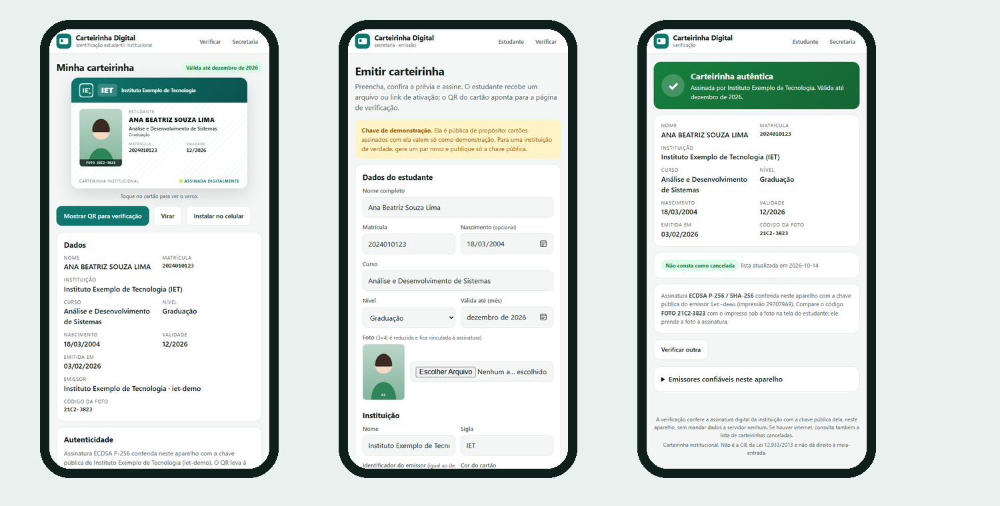

# Carteirinha Digital

Identificação estudantil **institucional** no celular, como PWA: a secretaria emite e **assina digitalmente**, o
estudante ativa uma vez e usa **sem internet**, e qualquer pessoa confere a autenticidade apontando a câmera para o
QR code, também sem internet e sem servidor.

Três páginas estáticas, sem framework e sem build:

| Página | Para quem | O que faz |
|---|---|---|
| `/` | estudante | ativa a carteirinha (arquivo, link ou código), guarda só no aparelho, mostra o cartão (frente/verso), o QR em tela cheia e instala como app |
| `/emitir/` | secretaria | preenche os dados, reduz a foto, assina com a chave privada da instituição e entrega o arquivo/link de ativação e o QR |
| `/v/` | quem verifica | lê o QR (câmera do celular ou `BarcodeDetector`), confere a assinatura com a chave pública do emissor e consulta a lista de canceladas quando há internet |

> **Não é a CIE.** Este projeto é uma carteirinha emitida pela própria instituição de ensino para uso interno
> (biblioteca, acesso, eventos, convênios próprios). Não é a Carteira de Identificação Estudantil da Lei
> 12.933/2013, não traz as marcas das entidades estudantis e não dá direito à meia-entrada.



## Como funciona

```
secretaria (emitir/)                 estudante (/)                      quem verifica (v/)
─────────────────────                ─────────────                      ──────────────────
dados + foto reduzida                abre o link / importa o arquivo    aponta a câmera para o QR
   │                                    │                                  │
   ├─ payload (JSON curto)              ├─ confere a assinatura            ├─ confere a assinatura com a
   ├─ hash da foto → payload.f          ├─ confere o hash da foto            chave pública do emissor
   └─ assina: ECDSA P-256 / SHA-256     └─ guarda em localStorage         ├─ mostra os dados e a validade
        │                                    (funciona offline)            └─ online: consulta revogadas.json
        ▼
   token = base64url(payload) . base64url(assinatura)
   QR  = https://…/v/#token        arquivo .json = { t: token, p: foto }
```

- **O que vai no QR:** matrícula, nome, curso, nível, validade, data de emissão, nascimento (se informado), o
  **código da foto** (8 hexadecimais do SHA-256 dela) e a assinatura. Cerca de 400 caracteres: QR versão 13.
  Nome, sigla, cor e logotipo da instituição vêm da entrada do emissor em `emissores.js`, não do token.
- **A foto não vai no QR.** Fica no aparelho do estudante, presa à assinatura pelo código, que o cartão imprime
  sob a foto e a verificação mostra para comparar.
- **Nada de segredo no cliente.** A chave privada fica com a instituição (no navegador da secretaria, se ela
  quiser salvar). O app e a verificação só carregam chaves públicas. Quem não está em `emissores.js` (nem foi
  adicionado à mão no aparelho de quem verifica) é "emissor desconhecido", mesmo com assinatura matematicamente válida.
- **O link de verificação leva os dados no fragmento (`#…`)**, que o navegador não envia ao servidor. A página é
  estática: a conferência acontece inteira no aparelho, com a Web Crypto API.
- **Revogação:** `revogadas.json` lista `emissor:matrícula` canceladas. A verificação consulta quando há rede e
  diz claramente quando não conseguiu consultar.
- **Vencida não é inválida:** a assinatura confere e a página mostra os dados, mas marca "autêntica, mas vencida".

## Demonstração

A instituição **Instituto Exemplo de Tecnologia** e os estudantes são inventados (as "fotos" são ilustrações). O
par de chaves de demonstração está no repositório de propósito, chave privada inclusive
(`chaves/demo-emissor.privada.json`): carteirinhas assinadas com ele valem só como exemplo.

- No app do estudante, **"Ver um exemplo"** ativa a carteirinha da Ana (válida até 12/2026).
- `exemplos/carlos.json` é uma carteirinha **vencida**; `exemplos/bruna.json`, uma **cancelada** pela instituição
  (está em `revogadas.json`). Importe em "Ativar carteirinha → Importar arquivo" para ver cada caso.
- Na secretaria, a chave de demonstração já vem carregada: preencha, assine e teste a verificação no mesmo aparelho.

Para rodar localmente (Service Worker e Web Crypto exigem `localhost` ou HTTPS):

```
python -m http.server 8766 --bind 127.0.0.1
# http://127.0.0.1:8766/
```

## PWA

`manifest.webmanifest` + `sw.js`: instalável (botão "Instalar no celular" quando o navegador oferece; no iPhone,
Compartilhar → Adicionar à Tela de Início), ícones próprios, atalhos ("Mostrar QR", "Verificar") e **todo o app
em cache** na instalação, inclusive a página de verificação e os exemplos. `revogadas.json` e `emissores.js` são
buscados primeiro na rede e caem no cache sem ela. Para publicar uma versão nova, suba `VERSAO` no `sw.js`.

## Adotar numa instituição

1. Na secretaria, **"Gerar par de chaves novo"**. Guarde a privada (e salve no navegador, se for emitir dali).
   Suba o logotipo e defina nome, sigla e cor: isso é o que aparece na faixa do cartão.
2. Copie a entrada da chave **pública** para o `emissores.js` do seu deploy (ou, para testar antes, cole em
   "Emissores confiáveis neste aparelho" na página de verificação).
3. Emita: arquivo de ativação por e-mail institucional ou portal do aluno; link quando não der para anexar.
4. Para cancelar uma carteirinha, acrescente `emissor:matrícula` em `revogadas.json`.

## Testes

```
node --test tests/
```

Node 20+, sem dependências: codificação, hash, geração de chaves, assinatura e verificação (adulteração, chave
errada e emissor desconhecido), validade, formatos de ativação, QR e os exemplos publicados conferidos contra a chave
de demonstração. A integração contínua roda os testes e confere que tudo que o Service Worker pré-carrega existe.

## Estrutura

```
index.html  app.js  app.css     app do estudante
emitir/                         secretaria: emissão e assinatura
v/                              verificação (QR, câmera, emissores confiáveis)
comum.js                        codificação, hash, chaves, token, validade, ativação (navegador e Node)
cartao.js                       o cartão (frente/verso) em HTML, usado no app e na prévia da secretaria
emissores.js                    emissores em que a verificação confia: nome, sigla, cor, logo e chave PÚBLICA
revogadas.json                  carteirinhas canceladas (emissor:matrícula)
lib/qrcode.js                   codificador de QR Code (Kazuhiko Arase, MIT), empacotado como módulo ES
sw.js  manifest.webmanifest     PWA
exemplos/  chaves/              demonstração (dados fictícios; a chave privada de demonstração é pública)
ferramentas/preparar-demo.mjs   gera chaves, emissores.js, exemplos e revogadas.json
ferramentas/icones.py           ícones da PWA (Pillow)
tests/                          node:test
```

## Licença

MIT. O codificador de QR Code em `lib/qrcode.js` é de Kazuhiko Arase, também MIT.
